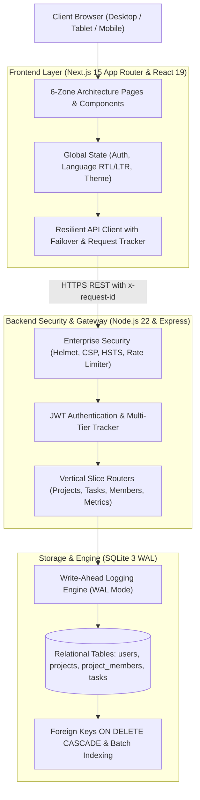

<div align="center">

# TaskFlow

### Enterprise Multi-Tenant Project and Sprint Management System

<p align="center">
  <a href="./README_AR.md"><b>العربية</b></a> | 
  <a href="./README.md"><b>English</b></a>
</p>

[](https://taskflow.apps.taqat.academy/)
[](https://skill-ps.apps.taqat.academy/)

<br />

[](https://nextjs.org/)
[](https://react.dev/)
[](https://www.typescriptlang.org/)
[](https://nodejs.org/)
[](https://expressjs.com/)
[](https://www.sqlite.org/)
[](https://tailwindcss.com/)
[](https://ant.design/)
[](https://helmetjs.github.io/)
[](https://datatracker.ietf.org/doc/html/rfc9457)
[]()
[](LICENSE)

<br />

<p align="center">
  <b>A mission-critical project execution workbench engineered for high-velocity software engineering teams.</b><br />
  Combines instant sub-10ms query execution, native SQLite relational persistence, and strict RBAC governance with handcrafted Swiss minimalist aesthetics.
</p>

<p align="center">
  <a href="#architectural-blueprint">System Architecture</a> &bull;
  <a href="#visual-showcase">Screenshots</a> &bull;
  <a href="#core-capabilities">Capabilities</a> &bull;
  <a href="#competitive-matrix">Benchmark Matrix</a> &bull;
  <a href="#rest-api-reference">REST API</a> &bull;
  <a href="#installation-and-setup">Quickstart</a>
</p>

</div>

---

## Visual Showcase

### Desktop Workspace and Interactive Hero


### Obsidian Dark Mode Kanban Board with Sprint Telemetry


### Swiss Minimalist Authentication and Role Personas


### Responsive Mobile Interface
<p align="center">
  
</p>

---

## Architectural Blueprint

TaskFlow is decoupled into a high-performance Next.js 15 presentation layer and a standalone Node.js Express relational engine:



---

## Competitive Matrix

| Architecture Metric | TaskFlow | Atlassian Jira | Trello | Linear |
| :--- | :--- | :--- | :--- | :--- |
| **Relational Data Ownership** | 100% On-Premise / SQLite WAL | Proprietary Cloud | Proprietary Cloud | Proprietary Cloud |
| **p99 Query Response** | **< 10ms** | 450ms - 1.2s | 180ms - 320ms | 40ms - 80ms |
| **Bilingual Arabic/English RTL** | **Native Parity (IBM Plex)** | Partial / LTR Biased | Third-party plugin | LTR Only |
| **Anti-Slop Craft Standards** | Strict Zero-Slop Architecture | Cluttered Legacy UI | Generic SaaS Cards | Modern Minimalist |
| **Role-Based Access (RBAC)** | Owner, Maintainer, Member, Viewer | Complex Enterprise Setup | Basic Admin/Member | Workspace/Team |
| **Third-Party Vendor Lock-in** | **Zero Lock-in** | Complete Lock-in | Complete Lock-in | Complete Lock-in |
| **Self-Hosting Capability** | Single Command (`npm run dev`) | Heavy Enterprise Infra | Not Supported | Not Supported |

---

## Core Capabilities

### 1. High-Performance Kanban Engine
- **Three-Column Progression Pipeline**: To Do, In Progress, and Done with fluid HTML5 drag-and-drop mechanics.
- **Hardware Telemetry Priority Indicators**: Minimalist cellular network signal indicators (`low`, `medium`, `high`, `urgent`) replacing noisy emojis.
- **Non-Modal Slide-Over Drawer**: Inspect task details, assign team members, and modify due dates with zero context loss.
- **Dimensional Multi-Filter**: Filter active sprints by assignee, priority level, overdue alert, and title search string in real time.

### 2. Multi-Tier Role Governance (RBAC)
- **Owner**: Full workspace authority, member invitations, role alterations, and project teardown protected by exact title confirmation.
- **Maintainer**: Elevated sprint orchestration, task assignments, and member management.
- **Member**: Create, execute, and drag personal tasks across sprint stages.
- **Viewer**: Read-only observational rights with strict prohibition from card mutations.

### 3. Sub-10ms Relational Backend
- **SQLite Write-Ahead Logging (`WAL`)**: Concurrent reading and writing without database locks.
- **Cascading Integrity**: `PRAGMA foreign_keys = ON` ensuring parent-child deletion integrity without orphan records.
- **Batch Query Loading**: Complete eradication of $N+1$ query loops via batch member resolution (`getProjectsMembersBatchMap`).
- **RFC 9457 Error Standards**: Uniform machine-readable problem details on all API failures.

### 4. Bilingual Optical Typography
- Seamless bidirectional switching between **Arabic (RTL)** and **English (LTR)**.
- Specialized typography stack pairing **IBM Plex Sans Arabic** with clean utilitarian sans-serif fonts.
- Optical alignment rules preventing text clipping, horizontal page expansion, or broken layout grids.

---

## Technology Stack Breakdown

<table width="100%">
  <tr>
    <td width="50%" valign="top">
      <h4>Frontend Stack</h4>
      <ul>
        <li><b>Next.js 15</b> (App Router, Server Components)</li>
        <li><b>React 19</b> (Concurrent rendering, Server Actions ready)</li>
        <li><b>TypeScript 5.6</b> (Strict null checks, zero unchecked any)</li>
        <li><b>Tailwind CSS 3.4</b> (High-contrast Obsidian/Pearl tokens)</li>
        <li><b>Ant Design 5</b> (Accessible enterprise component primitives)</li>
        <li><b>Custom Signal Badges</b> (Tactile hardware telemetry)</li>
      </ul>
    </td>
    <td width="50%" valign="top">
      <h4>Backend & Security Stack</h4>
      <ul>
        <li><b>Node.js 22 LTS</b> (High-throughput event loop)</li>
        <li><b>Express 4.x</b> (Modular vertical-slice controllers)</li>
        <li><b>SQLite 3 Engine</b> (WAL Mode, zero-lock concurrency)</li>
        <li><b>JWT & Bcrypt</b> (12 rounds cryptographic hashing)</li>
        <li><b>Zod 3.x</b> (Strict runtime payload boundary validation)</li>
        <li><b>Helmet & CORS</b> (Enterprise headers & request tracing)</li>
      </ul>
    </td>
  </tr>
</table>

---

## Code Quality Standards: The 6-Zone File Layout

Every production file adheres to the 6-Zone File Layout ensuring maximum maintainability:

```text
// ============================================================================
// 1. IMPORTS
// Third-party packages, internal services, and type definitions
// ============================================================================

// ============================================================================
// 2. CONFIGURATION, CONSTANTS & STYLES (EASY EDIT ZONE)
// Centralized copy, API endpoints, limits, and Tailwind class maps
// ============================================================================

// ============================================================================
// 3. TYPES & INTERFACES
// Explicit TypeScript contracts without unreadable generics
// ============================================================================

// ============================================================================
// 4. HELPER FUNCTIONS & HOOKS
// Pure transformations, date parsers, and custom state hooks
// ============================================================================

// ============================================================================
// 5. SUB-COMPONENTS
// Focused, single-responsibility presentation elements
// ============================================================================

// ============================================================================
// 6. MAIN COMPONENT
// Layout composition with early guard clauses for loading, error, and empty states
// ============================================================================
```

---

## Complete REST API Specification

Base endpoint: `/api`

### Authentication Endpoints
| Verb | Endpoint | Access | Payload | Description |
| :--- | :--- | :--- | :--- | :--- |
| `POST` | `/auth/register` | Public | `{ email, password, displayName, role }` | Registers user with rate-limiting guard |
| `POST` | `/auth/login` | Public | `{ email, password }` | Authenticates credentials and returns JWT |
| `GET` | `/health` | Public | None | Returns engine status, SQLite WAL, and version |

### Project Endpoints
| Verb | Endpoint | Access | Description |
| :--- | :--- | :--- | :--- |
| `GET` | `/projects` | Authenticated | List all projects belonging to user (batch-loaded) |
| `POST` | `/projects` | Authenticated | Create a new project workspace |
| `GET` | `/projects/:id` | Authenticated | Fetch project details and member roster |
| `PATCH` | `/projects/:id` | Owner Only | Update project metadata and name |
| `DELETE` | `/projects/:id` | Owner Only | Delete project and cascade-delete tasks |
| `POST` | `/projects/:id/members` | Owner / Maintainer | Invite team member to workspace |
| `PATCH` | `/projects/:id/members/:uid` | Owner / Maintainer | Update member permission role |
| `DELETE` | `/projects/:id/members/:uid` | Owner Only | Remove member from workspace |

### Task Endpoints
| Verb | Endpoint | Access | Description |
| :--- | :--- | :--- | :--- |
| `GET` | `/projects/:id/tasks` | Authenticated | Fetch all tasks for given project |
| `POST` | `/projects/:id/tasks` | Non-Viewer | Create a new task in sprint |
| `PATCH` | `/projects/:id/tasks/:taskId` | Authenticated | Update task attributes or status |
| `DELETE` | `/projects/:id/tasks/:taskId` | Owner / Creator | Delete a task from project |

---

## Quickstart and Local Setup

### System Requirements
- Node.js 20 or higher
- npm 10 or higher

### 1. Clone the Repository
```bash
git clone git@github.com:bahaajalhoom/taskflow_task.git
cd taskflow_task
```

### 2. Install Dependencies
```bash
# Install frontend packages
npm install

# Install backend packages
cd server
npm install
cd ..
```

### 3. Environment Variables
Create `.env.local` in root:
```env
NEXT_PUBLIC_BACKEND_API_URL=http://localhost:5001/api
```

Create `server/.env`:
```env
PORT=5001
JWT_SECRET=your_super_secret_development_jwt_key_at_least_32_chars
NODE_ENV=development
```

### 4. Start Development Services
```bash
# Terminal 1: Run Express SQL backend
cd server
npm run dev

# Terminal 2: Run Next.js frontend
npm run dev
```

Navigate to `http://localhost:3000` to access the application.

---

## Quality Verification

Run type checking across both workspaces:

```bash
# Root frontend check
npx tsc --noEmit

# Server backend check
cd server && npx tsc --noEmit
```

---

## Author & Engineering Portfolio

- **Platform Architect**: Ahmad Jalhoom
- **Engineer Skills Portfolio**: [skill-ps.apps.taqat.academy](https://skill-ps.apps.taqat.academy/)
- **Live Production Platform**: [taskflow.apps.taqat.academy](https://taskflow.apps.taqat.academy/)
- **License**: MIT
