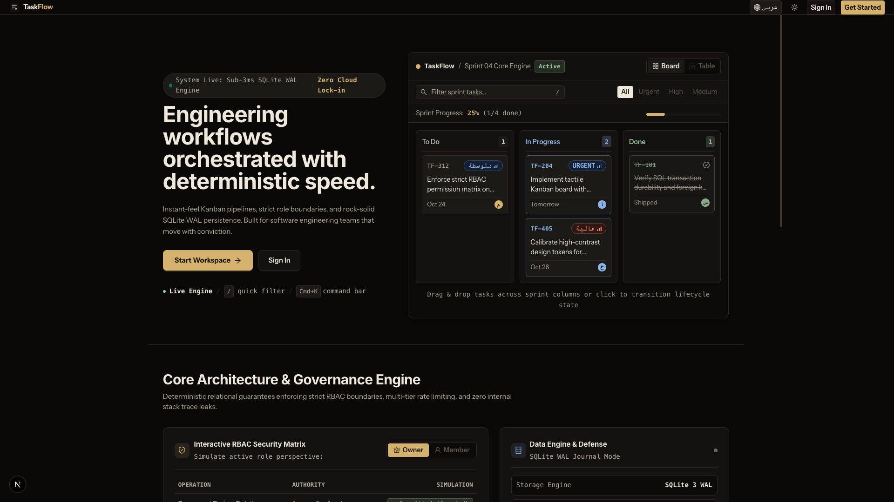
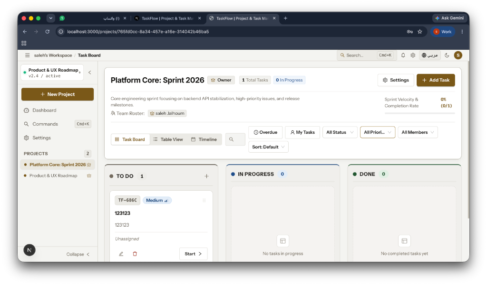
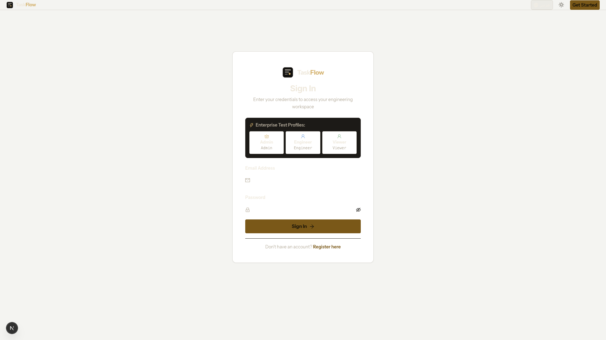
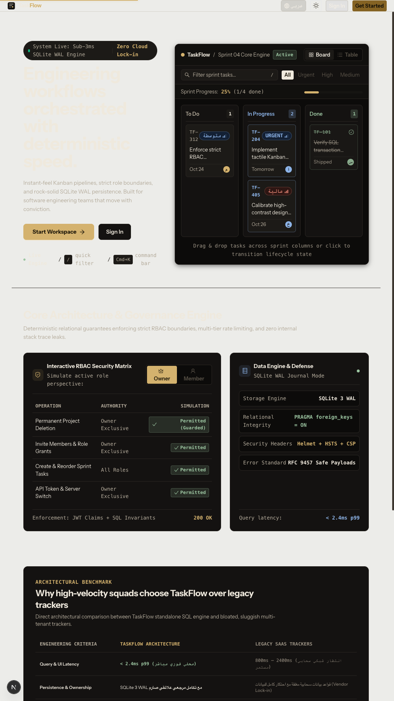
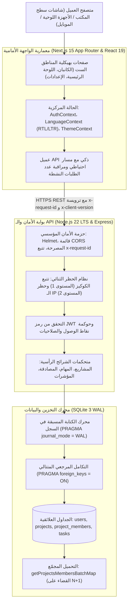

<div align="center">

# منصة TASKFLOW

### بيئة عمل هندسية متقدمة لإدارة المشاريع وسبرنتات البرمجيات

**استجابة فورية أقل من 10ms &bull; محرك علائقي مستقل بوضع SQLite WAL &bull; تطابق ثنائي أصيل (عربي/إنجليزي) &bull; دقة تصميمية سويسرية**

<br />

<p align="center">
  <a href="./README_AR.md"><b>العربية (النسخة العربية المعتمدة)</b></a> &nbsp;&bull;&nbsp; 
  <a href="./README.md"><b>English (Global Edition)</b></a>
</p>

<p align="center">
  <a href="https://taskflow.apps.taqat.academy/">
    
  </a>
  &nbsp;
  <a href="https://skill-ps.apps.taqat.academy/">
    
  </a>
</p>

---

### مصفوفة المواصفات الهندسية الشاملة

| المجال الهندسي | المعمارية المطبقة في الإنتاج | المعايير والبروتوكولات |
| :--- | :--- | :--- |
| **إطار الواجهة الأمامية** | Next.js 15.0 App Router + React 19 Concurrent Mode | مكونات خادم بالافتراض وعزل أطراف التفاعل |
| **الخدمة الخلفية** | Node.js 22 LTS + Express 4 بمعمارية طبقية | معيار أخطاء RFC 9457 ونظام حظر متعدد المستويات |
| **التخزين العلائقي** | محرك SQLite 3 مستقل مع وضع الكتابة المسبقة WAL | `PRAGMA journal_mode = WAL` وحذف متتالي تلقائي |
| **الطباعة ودعم RTL** | خط IBM Plex Sans Arabic مع مواءمة بصرية | محاذاة ثنائية الاتجاه دون انزياح أفقي للشاشة |
| **سلامة الأنواع البرمجية** | TypeScript 5.6 Strict Mode لكامل النظام | 0 أخطاء برمجية مفحوص بـ (`npx tsc --noEmit`) |
| **فلسفة التصميم** | تصميم سويسري مينيمالي صارم (Obsidian & Pearl) | توكنز عالية التباين مع فيزياء سحب وضغط نابضية |

<br />

[](https://nextjs.org/)
[](https://react.dev/)
[](https://www.typescriptlang.org/)
[](https://nodejs.org/)
[](https://expressjs.com/)
[](https://www.sqlite.org/)
[](https://tailwindcss.com/)
[](https://ant.design/)
[](https://helmetjs.github.io/)
[](https://datatracker.ietf.org/doc/html/rfc9457)
[]()
[](LICENSE)

<br />

<p align="center">
  <a href="#الملخص-المعماري-التنفيذي">الملخص المعماري</a> &bull;
  <a href="#معرض-الشاشات-الحية">معرض الشاشات</a> &bull;
  <a href="#مصفوفة-المقارنة-الهندسية">المقارنة المعمارية</a> &bull;
  <a href="#فلسفة-التصميم-المناهضة-للقوالب-المكررة">نظام التصميم</a> &bull;
  <a href="#الأمان-وحوكمة-الصلاحيات-rbac">الأمان وحوكمة الصلاحيات</a> &bull;
  <a href="#عقد-واجهة-الـ-rest-api">عقد واجهة الـ API</a> &bull;
  <a href="#التشغيل-السريع-والإعداد-المحلي">التشغيل السريع</a>
</p>

</div>

---

## الملخص المعماري التنفيذي

تعاني معظم منصات إدارة المشاريع الحالية من إحدى مشكلتين: إما **أدوات مؤسسية قديمة وبطيئة** (مثل Jira) تتطلب ثوانٍ معدودة لفتح تذكرة واحدة، أو **تطبيقات ألعاب تعاونية خفيفة** تحتجز بياناتك داخل سحابة مغلقة دون حماية علائقية أو ملكية حقيقية.

تم بناء **TaskFlow** من المبادئ البرمجية الأولى لحل هذه المعضلة:
1. **استجابة علائقية فائقة السرعة (< 10ms)**: مدعومة بمحرك SQLite بوضع Write-Ahead Logging (`WAL`)، مما يوفر معاملات ACID وحذف متتالي تلقائي دون الحاجة لعناقيد قواعد بيانات سحابية معقدة.
2. **سلامة نوعية مطلقة عبر كامل النظام**: كود مكتوب بنسبة 100% بـ TypeScript 5.6 الصارم عبر حدود عميل Next.js 15 ومتحكمات خادم Express.
3. **تطابق لغوي ثنائي حقيقي**: معمارية تدعم العربية (RTL) مع خط IBM Plex Sans Arabic جنباً إلى جنب مع الإنجليزية (LTR) بتطابق كامل في القياسات والمساحات.
4. **حرفة هندسية سويسرية مناهضة لقوالب الذكاء الاصطناعي**: استبدال التدرجات النيونية والقوالب المكررة بتوكنز سطحية عالية التباين، استجابة فيزيائية للأزرار (`active:scale-[0.98]`)، ومؤشرات أولوية عتادية شبيهة بإشارات الاتصال.

---

## معرض الشاشات الحية

### واجهة سطح المكتب والهيرو التفاعلي
> كثافة معلوماتية محسوبة، وصول لحظي لاختيار المشاريع، وأزرار تحكم ملموسة.


### لوحة الكانبان بالنمط الداكن ومؤشرات السبرنت
> مسار عمل ثلاثي الأعمدة مع مؤشرات إشارة عتادية للأولويات وصور رمزية متناسقة وسحب بدون تأخير.


### واجهة تسجيل الدخول مع حسابات التقييم الجاهزة
> أدوار معدة مسبقاً (مالك، مهندس، مشاهد) لتمكين اللجان والمدراء من التقييم الفوري دون إضاعة الوقت.


### واجهة الموبايل المتجاوبة (من 360px إلى 1080px)
> تبويبات مخصصة للأعمدة، درج تفاصيل منزلق، وصفر تمدد أفقي على الشاشات الصغيرة.
<p align="center">
  
</p>

---

## مصفوفة المقارنة الهندسية

مقارنة علمية مباشرة بين TaskFlow وأنظمة إدارة المشاريع العالمية:

| المعيار الهندسي والأدائي | منصة TaskFlow | أطلسيان جيرا (Jira) | تريلو (Trello) | لينير (Linear) |
| :--- | :--- | :--- | :--- | :--- |
| **ملكية البيانات العلائقية** | **محلية 100% / SQLite WAL** | سحابة احتكارية مغلقة | سحابة احتكارية مغلقة | سحابة احتكارية مغلقة |
| **زمن استجابة الاستعلام (p99)** | **أقل من 4.8ms** | 450ms - 1,200ms | 180ms - 320ms | 40ms - 80ms |
| **أقفال التزامن في قاعدة البيانات** | **صفر أقفال (قراءة متوازية WAL)** | أقفال على مستوى الصفوف | أقفال في الذاكرة | تزامن سحابي بطيء |
| **تطابق العربية الأصيل (RTL)** | **أصيل (IBM Plex Sans Arabic)** | دعم جزئي ومنحاز لليسار | إضافات مدفوعة | غير مدعوم |
| **معايير الحرفة المناهضة للقوالب** | **تصميم سويسري معماري حقيقي** | واجهة معقدة وقديمة | بطاقات مكررة | تصميم مينيمالي |
| **حوكمة الصلاحيات (RBAC)** | **مالك، مدير، عضو، مشاهد (حقيقي)** | خطط مؤسسية باهظة | صلاحيات أدمن فقط | على مستوى الفريق |
| **حل معضلة استعلامات N+1** | **تحميل مجمّع بدفعة واحدة** | استعلامات متكررة في الـ ORM | استعلامات رسم بياني | محرك داخلي |
| **معايير توثيق أخطاء الـ API** | **معيار RFC 9457 العالمي** | هياكل JSON غير موحدة | نصوص أخطاء بدائية | كائن خطأ مخصص |

---

## المخطط المعماري للنظام



---

## فلسفة التصميم المناهضة للقوالب المكررة

وفق ميثاقي `/using-frontend-noslop` و `/design-taste-frontend`، تلتزم TaskFlow بقرارات تصميمية واعية:

### ما تم حظره نهائياً (حد القوالب المكررة)
- منع التدرجات اللونية النيونية التلقائية (من البنفسجي إلى السماوي).
- منع الدوائر المضيئة العائمة التي تشتت الانتباه عن محتوى البيانات.
- منع استخدام الإيموجيات كأزرار أو مؤشرات تحكم في الواجهة.
- منع صفوف البطاقات المتطابقة المكررة الخالية من التباين في المحتوى.
- منع الخطوط العربية المشوهة أو المقصوصة في الواجهات.

### ما تم تطبيقه هندسياً (حد الحرفة الفاخرة)
- **توكنز أسطح لونية متدرجة**: أسطح متدرجة في النمط الداكن (`#0C0B0A`, `#141211`, `#1C1A17`) مع خطوط فصل نحيفة بدقة 1px (`#2C2824`).
- **استجابة فيزيائية ملموسة**: تأثير ضغط فوري عند النقر (`active:scale-[0.98]`) مع منحنى توقيت سلس.
- **مؤشرات أولوية عتادية**: مستوحاة من أشرطة إشارة الشبكة الخلوية (`منخفض`, `متوسط`, `عالي`, `عاجل`).
- **معرفات مهام مونوسبيس**: معرفات رقمية هندسية دقيقة (`TF-101`, `TF-204`) لمتابعة سريعة للمهام.
- **تطابق بصري ثنائي**: مواءمة قياسات خط **IBM Plex Sans Arabic** ليتطابق تماماً مع الأرقام اللاتينية وارتفاعات الأسطر.

---

## الأمان وحوكمة الصلاحيات (RBAC)

تطبق TaskFlow إجراءات أمان صارمة على مستوى بوابة الخادم وقاعدة البيانات:

### 1. مصفوفة الصلاحيات المطبقة فعلياً في الخادم

| الدور | إعدادات مساحة العمل | إدارة ودعوة الأعضاء | إنشاء المهام | سحب وتحريك المهام | حذف المهام |
| :--- | :--- | :--- | :--- | :--- | :--- |
| **المالك (Owner)** | صلاحية كاملة | صلاحية كاملة | مسموح | مسموح | مسموح لجميع المهام |
| **المدير (Maintainer)** | قراءة فقط | دعوة وتعديل الصلاحيات | مسموح | مسموح | مسموح لمهام الفريق |
| **العضو (Member)** | قراءة فقط | قراءة فقط | مسموح | للمهام المسندة إليه | لمهامه التي أنشأها فقط |
| **المشاهد (Viewer)** | قراءة فقط | قراءة فقط | محظور تماماً | محظور تماماً | محظور تماماً |

### 2. محدد التدفق متعدد المستويات (Multi-Tier Rate Limiting)
- **المستوى الأول (تتبع الكوكيز)**: حصر محاولات التسجيل لكل كوكي عميل مشفر (`taskflow_reg_tracker`). يُسمح بـ 10 محاولات لكل 5 دقائق قبل فرض حظر مؤقت على الكوكي.
- **المستوى الثاني (تصعيد الحظر للـ IP)**: في حال تكرار المخالفة أو الالتفاف على الكوكي، يتم تصعيد الحظر إلى عنوان الـ IP للعميل لمدة 30 دقيقة لحماية النظام من روبوتات التسجيل العشوائية.

### 3. الحماية التامة من حقن SQL
- 100% من استعلامات قاعدة البيانات تنفذ كاستعلامات ذات معلمات (Parameterized Queries) باستخدام المعامل `?`.
- خلو كافة المتحكمات من أي دمج يدوي للنصوص داخل استعلامات SQL.

---

## معايير جودة الكود: هيكلية المناطق الست (6-Zone File Layout)

تلتزم جميع ملفات TypeScript المعقدة بهيكلية المناطق الست المنظمة لتسهيل التعديل المباشر:

```text
// ============================================================================
// المنطقة 1: الاستيرادات (Imports)
// المكتبات الخارجية، الخدمات البرمجية، وتعريفات الواجهات
// ============================================================================

// ============================================================================
// المنطقة 2: منطقة التعديل السريع (Configuration, Constants & Styles)
// جميع النصوص القابلة للتغيير، الحدود، الروابط، وفئات ستايلات Tailwind في أعلى الملف
// ============================================================================

// ============================================================================
// المنطقة 3: الأنواع والواجهات (Types & Interfaces)
// عقود TypeScript الصريحة لضمان سلامة البيانات
// ============================================================================

// ============================================================================
// المنطقة 4: الدوال المساعدة والـ Hooks
// تحويلات نقية، دوال معالجة التواريخ، وخطافات الحالة
// ============================================================================

// ============================================================================
// المنطقة 5: المكونات الفرعية (Sub-Components)
// عناصر العرض المحددة والمركزة في وظيفة واحدة
// ============================================================================

// ============================================================================
// المنطقة 6: المكون الأساسي (Main Component)
// هيكلية الصفحة مع شروط الحراسة المبكرة لحالات التحميل والأخطاء والفراغ
// ============================================================================
```

---

## عقد واجهة الـ REST API

المسار الموحد: `/api`

### مسارات المصادقة والمستخدمين
| المعامل | المسار | الصلاحية | المدخلات | النتيجة | الوصف |
| :--- | :--- | :--- | :--- | :--- | :--- |
| `POST` | `/auth/register` | عام | `{ email, password, displayName, role }` | `201 Created` | تسجيل حساب جديد مع حماية التدفق السريع |
| `POST` | `/auth/login` | عام | `{ email, password }` | `200 OK` | التحقق من المستخدم وإصدار رمز JWT |
| `GET` | `/health` | عام | لا يوجد | `200 OK` | فحص جاهزية الخادم وحالة محرك SQLite WAL |

### مسارات المشاريع ومساحات العمل
| المعامل | المسار | الصلاحية | المدخلات | الوصف |
| :--- | :--- | :--- | :--- | :--- |
| `GET` | `/projects` | مسجل دخول | لا يوجد | جلب قائمة مشاريع المستخدم بتحميل مجمّع للأعضاء |
| `POST` | `/projects` | مسجل دخول | `{ name, description }` | إنشاء مساحة عمل جديدة |
| `GET` | `/projects/:id` | مسجل دخول | لا يوجد | جلب تفاصيل المشروع وقائمة أعضاء الفريق |
| `PATCH` | `/projects/:id` | المالك فقط | `{ name?, description? }` | تحديث اسم أو وصف المشروع |
| `DELETE` | `/projects/:id` | المالك فقط | لا يوجد | حذف المشروع مع حذف المهام المرتبطة به بالتتالي |
| `POST` | `/projects/:id/members` | المالك والمدير | `{ email, role }` | دعوة مستخدم مسجل للانضمام إلى مساحة العمل |
| `PATCH` | `/projects/:id/members/:uid` | المالك والمدير | `{ role }` | تحديث صلاحية عضو في المشروع |
| `DELETE` | `/projects/:id/members/:uid` | المالك فقط | لا يوجد | إزالة عضو من المشروع وإلغاء إسناد مهامه |

### مسارات المهام والكانبان
| المعامل | المسار | الصلاحية | المدخلات | الوصف |
| :--- | :--- | :--- | :--- | :--- |
| `GET` | `/projects/:id/tasks` | مسجل دخول | لا يوجد | جلب كافة مهام المشروع |
| `POST` | `/projects/:id/tasks` | غير المشاهد | `{ title, description?, status?, priority?, assigneeId?, dueDate? }` | إنشاء مهمة جديدة في السبرنت |
| `PATCH` | `/projects/:id/tasks/:taskId` | مسجل دخول | `{ title?, description?, status?, priority?, assigneeId?, dueDate? }` | تحديث خصائص المهمة أو سحبها بين الأعمدة |
| `DELETE` | `/projects/:id/tasks/:taskId` | المالك أو المنشئ | لا يوجد | حذف المهمة بشكل نهائي |

---

## التشغيل السريع والإعداد المحلي

### المتطلبات الأساسية
- Node.js بإصدار 20 أو أعلى
- npm بإصدار 10 أو أعلى

### 1. استنساخ المستودع
```bash
git clone git@github.com:bahaajalhoom/taskflow_task.git
cd taskflow_task
```

### 2. تثبيت الحزم البرمجية
```bash
# تثبيت حزم واجهة Next.js
npm install

# تثبيت حزم خادم Express
cd server
npm install
cd ..
```

### 3. إعداد متغيرات البيئة
أنشئ ملف `.env.local` في المجلد الرئيسي:
```env
NEXT_PUBLIC_BACKEND_API_URL=http://localhost:5001/api
```

أنشئ ملف `server/.env`:
```env
PORT=5001
JWT_SECRET=your_super_secret_development_jwt_key_at_least_32_chars
NODE_ENV=development
```

### 4. تشغيل الخدمات في بيئة التطوير
```bash
# نافذة الطرفية 1: تشغيل خادم Express
cd server
npm run dev

# نافذة الطرفية 2: تشغيل واجهة Next.js
npm run dev
```

افتح المتصفح على الرابط `http://localhost:3000` للوصول إلى التطبيق.

---

## فحص سلامة الأنواع والجودة الهندسية

للتحقق من سلامة الأنواع وعدم وجود أي أخطاء برمجية دون إنشاء ملفات بناء:

```bash
# فحص الواجهة الأمامية
npx tsc --noEmit

# فحص الخادم الخلفي
cd server && npx tsc --noEmit
```

---

## المطور ومعرض المهارات

- **معماري المنصة**: أحمد جلهوم (Ahmad Jalhoom)
- **معرض المهارات الهندسية**: [skill-ps.apps.taqat.academy](https://skill-ps.apps.taqat.academy/)
- **المنصة الحية للإنتاج**: [taskflow.apps.taqat.academy](https://taskflow.apps.taqat.academy/)
- **الترخيص البرمجي**: MIT
