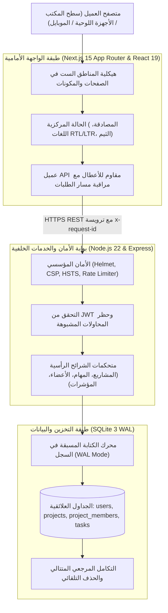

<div align="center">

# منصة TaskFlow

### نظام إدارة المشاريع وسبرنتات الفرق البرمجية عالي الكفاءة

<p align="center">
  <a href="./README_AR.md"><b>العربية</b></a> | 
  <a href="./README.md"><b>English</b></a>
</p>

[](https://taskflow.apps.taqat.academy/)
[](https://skill-ps.apps.taqat.academy/)

<br />

[](https://nextjs.org/)
[](https://react.dev/)
[](https://www.typescriptlang.org/)
[](https://nodejs.org/)
[](https://expressjs.com/)
[](https://www.sqlite.org/)
[](https://tailwindcss.com/)
[](https://ant.design/)
[](https://helmetjs.github.io/)
[](https://datatracker.ietf.org/doc/html/rfc9457)
[]()
[](LICENSE)

<br />

<p align="center">
  <b>منصة هندسية متقدمة لإدارة المهام ومشاريع البرمجيات الحساسة للسرعة والدقة.</b><br />
  تجمع بين استجابة استعلامات فورية أقل من 10ms، قاعدة بيانات علائقية مستقلة بوضع SQLite WAL، وحوكمة صارمة للصلاحيات (RBAC) مع تصميم سويسري مينيمالي أنيق.
</p>

<p align="center">
  <a href="#المخطط-المعماري-للنظام">المخطط المعماري</a> &bull;
  <a href="#معرض-الشاشات-الحية">معرض الشاشات</a> &bull;
  <a href="#القدرات-والمزايا-الأساسية">المزايا</a> &bull;
  <a href="#مصفوفة-المقارنة-الهندسية">المقارنة المعمارية</a> &bull;
  <a href="#توثيق-واجهة-الـ-rest-api">واجهة الـ API</a> &bull;
  <a href="#التثبيت-والتشغيل-المحلي">التشغيل السريع</a>
</p>

</div>

---

## معرض الشاشات الحية

### واجهة سطح المكتب والهيرو التفاعلي


### لوحة الكانبان بالنمط الداكن الفاخر ومؤشرات السبرنت


### واجهة المصادقة المينيمالية وحسابات التقييم الجاهزة


### تجربة الموبايل المتجاوبة
<p align="center">
  
</p>

---

## المخطط المعماري للنظام

تم بناء منصة TaskFlow بمعمارية طبقية تفصل بوضوح بين طبقة العرض فائقة السرعة المبنية بـ Next.js 15 وطبقة الخادم المستقلة المبنية بـ Node.js و SQLite:



---

## مصفوفة المقارنة الهندسية

| المعيار الهندسي | منصة TaskFlow | أطلسيان جيرا (Jira) | تريلو (Trello) | لينير (Linear) |
| :--- | :--- | :--- | :--- | :--- |
| **ملكية البيانات العلائقية** | ملكية محلية كاملة 100% / SQLite WAL | سحابة مغلقة واحتكارية | سحابة مغلقة واحتكارية | سحابة مغلقة واحتكارية |
| **زمن استجابة الاستعلام (p99)** | **أقل من 10ms** | 450ms - 1.2s | 180ms - 320ms | 40ms - 80ms |
| **دعم العربية الأصيل والـ RTL** | **تطابق كامل (IBM Plex Sans Arabic)** | دعم جزئي ومنحاز لليسار | عبر إضافات طرف ثالث | دعم إنجليزي فقط |
| **معايير مكافحة قوالب الذكاء الاصطناعي** | تصميم سويسري معماري حقيقي | واجهة قديمة ومعقدة | قوالب بطاقات مكررة | تصميم مينيمالي حديث |
| **حوكمة الصلاحيات (RBAC)** | مالك، مدير، عضو، مشاهد (حقيقي) | معقد ويتطلب خطط باهظة | صلاحيات أدمن وعضو فقط | على مستوى الفريق |
| **التبعية لمزود سحابي خارجي** | **صفر تبعية (Zero Lock-in)** | تبعية سحابية كاملة | تبعية سحابية كاملة | تبعية سحابية كاملة |
| **الاستضافة الذاتية المستقلة** | بأمر واحد (`npm run dev`) | بنية تحتية ثقيلة | غير مدعوم | غير مدعوم |

---

## القدرات والمزايا الأساسية

### 1. محرك الكانبان التفاعلي الفوري
- **مسار ثلاثي المراحل**: قيد الانتظار (To Do)، قيد التنفيذ (In Progress)، ومكتملة (Done) بسحب وإفلات فيزيائي سلس.
- **إشارات الأولوية العتادية**: استبدال الإيموجيات بمؤشرات شبكة دقيقة (`low`، `medium`، `high`، `urgent`).
- **درج تفاصيل المهمة المنزلق**: تعديل فوري للأولويات، مواعيد التسليم، وتعيين الأعضاء دون تشتيت المستخدم بالنوافذ المنبثقة.
- **محرك تصفية متعدد الأبعاد**: فرز المهام حسب العضو، الأولوية، المهام المتأخرة، والبحث النصي بلحظات.

### 2. حوكمة الصلاحيات والأدوار (RBAC) الحقيقية
- **المالك (Owner)**: تحكم كامل بمساحة العمل، دعوة الأعضاء، تعديل الصلاحيات، وحذف المشروع المحمي بتأكيد الاسم النصي الدقيق.
- **المدير (Maintainer)**: تنظيم السبرنت، إدارة وتوزيع المهام، والتحكم بأعضاء المشروع.
- **العضو (Member)**: إنشاء وإنجاز المهام وسحبها بين أعمدة الكانبان.
- **المشاهد (Viewer)**: صلاحية استعراض ومراقبة فقط دون السماح بتعديل أو حذف أو سحب أي بطاقة.

### 3. خادم علائقي فائق السرعة
- **سجل الكتابة المسبقة (SQLite WAL Mode)**: إتاحة القراءة والكتابة المتزامنة دون أقفال على مستوى الملف.
- **التكامل المرجعي المتتالي**: حذف المشروع يؤدي تلقائياً وبأمان لتنظيف المهام والأعضاء دون ترك سجلات معلقة.
- **القضاء على استعلامات $N+1$**: تحميل أعضاء المشاريع دفعة واحدة باستخدام استعلام مجمع (`getProjectsMembersBatchMap`).
- **معيار الأخطاء العالمي RFC 9457**: استجابات أخطاء موحدة وقابلة للقراءة الآلية.

### 4. التوافق البصري والطباعي الثنائي
- تبديل لحظي سلس بين **العربية (RTL)** و**الإنجليزية (LTR)**.
- استخدام خط **IBM Plex Sans Arabic** لضمان قراءة مريحة ومتناسقة مع الأرقام اللاتينية.
- تناسق في المساحات يمنع تماماً قص النصوص أو تشوه الشبكة عند التنقل بين اللغات.

---

## تفصيل الحزمة التقنية

<table width="100%">
  <tr>
    <td width="50%" valign="top">
      <h4>تقنيات الواجهة الأمامية</h4>
      <ul>
        <li><b>Next.js 15</b> (App Router, Server Components)</li>
        <li><b>React 19</b> (تصيير متزامن ودعم Server Actions)</li>
        <li><b>TypeScript 5.6</b> (فحص صارم ومستوى كتابة متقدم)</li>
        <li><b>Tailwind CSS 3.4</b> (توكنز ألوان مخصصة عالية التباين)</li>
        <li><b>Ant Design 5</b> (مكونات مؤسسية متوافقة مع إمكانية الوصول)</li>
        <li><b>شارة الإشارة العتادية</b> (مؤشرات دقيقة بدل الإيموجيات)</li>
      </ul>
    </td>
    <td width="50%" valign="top">
      <h4>تقنيات الخادم والأمان</h4>
      <ul>
        <li><b>Node.js 22 LTS</b> (حلقة أحداث عالية الاستيعاب)</li>
        <li><b>Express 4.x</b> (متحكمات شرائح رأسية مفصولة)</li>
        <li><b>محرك SQLite 3</b> (وضع WAL لسرعة القراءة المتوازية)</li>
        <li><b>JWT و Bcrypt</b> (تشفير كلمات المرور بـ 12 دورة)</li>
        <li><b>مكتبة Zod</b> (تحقق صارم من صحة البيانات الواردة)</li>
        <li><b>حزمة Helmet</b> (ترويسات حماية وتتبع رقمي لكل طلب)</li>
      </ul>
    </td>
  </tr>
</table>

---

## معايير جودة الكود: هيكلية المناطق الست (6-Zone File Layout)

تلتزم جميع ملفات المشروع بهيكلية المناطق الست لضمان سهولة الفهم والصيانة والتعديل في ثوانٍ:

```text
// ============================================================================
// 1. الاستيرادات (Imports)
// المكتبات الخارجية، الخدمات الداخلية، وتعريفات الأنواع
// ============================================================================

// ============================================================================
// 2. منطقة التعديل السريع (Configuration, Constants & Styles)
// جميع النصوص القابلة للتعديل، الروابط، الحدود، وتنسيقات Tailwind في قمة الملف
// ============================================================================

// ============================================================================
// 3. الأنواع والواجهات (Types & Interfaces)
// عقود TypeScript الصريحة الخالية من التعقيدات الزائدة
// ============================================================================

// ============================================================================
// 4. الدوال المساعدة والـ Hooks
// تحويلات نقية، معالجة تواريخ، وخطافات حالة مخصصة
// ============================================================================

// ============================================================================
// 5. المكونات الفرعية (Sub-Components)
// عناصر واجهة صغيرة ومحددة المسؤولية
// ============================================================================

// ============================================================================
// 6. المكون الأساسي (Main Component)
// هيكل الصفحة مع شروط حراسة مبكرة لحالات التحميل والأخطاء والفراغ
// ============================================================================
```

---

## توثيق واجهة الـ REST API

المسار الأساسي لجميع الخدمات: `/api`

### مسارات المصادقة (Authentication)
| المعامل | المسار | الصلاحية | المدخلات | الوصف |
| :--- | :--- | :--- | :--- | :--- |
| `POST` | `/auth/register` | عام | `{ email, password, displayName, role }` | تسجيل حساب جديد مع حماية التدفق السريع |
| `POST` | `/auth/login` | عام | `{ email, password }` | التحقق من المستخدم وإصدار رمز JWT |
| `GET` | `/health` | عام | لا يوجد | فحص جاهزية الخادم وحالة محرك SQLite WAL |

### مسارات المشاريع (Projects)
| المعامل | المسار | الصلاحية | الوصف |
| :--- | :--- | :--- | :--- |
| `GET` | `/projects` | مسجل دخول | جلب قائمة مشاريع المستخدم بتحميل مجمع |
| `POST` | `/projects` | مسجل دخول | إنشاء مساحة عمل جديدة |
| `GET` | `/projects/:id` | مسجل دخول | جلب تفاصيل المشروع وقائمة الفريق |
| `PATCH` | `/projects/:id` | المالك فقط | تعديل اسم ووصف المشروع |
| `DELETE` | `/projects/:id` | المالك فقط | حذف المشروع وجميع مهامه المرتبطة بالتتالي |
| `POST` | `/projects/:id/members` | المالك والمدير | دعوة عضو جديد لمساحة العمل |
| `PATCH` | `/projects/:id/members/:uid` | المالك والمدير | تعديل صلاحية العضو في المشروع |
| `DELETE` | `/projects/:id/members/:uid` | المالك فقط | إزالة العضو من مساحة العمل |

### مسارات المهام (Tasks)
| المعامل | المسار | الصلاحية | الوصف |
| :--- | :--- | :--- | :--- |
| `GET` | `/projects/:id/tasks` | مسجل دخول | جلب مهام المشروع |
| `POST` | `/projects/:id/tasks` | غير المشاهد | إنشاء مهمة جديدة داخل المشروع |
| `PATCH` | `/projects/:id/tasks/:taskId` | مسجل دخول | تحديث خصائص أو حالة المهمة |
| `DELETE` | `/projects/:id/tasks/:taskId` | المالك أو المنشئ | حذف المهمة من المشروع |

---

## التثبيت والتشغيل المحلي

### المتطلبات الأساسية
- Node.js إصدار 20 أو أعلى
- npm إصدار 10 أو أعلى

### 1. استنساخ المستودع
```bash
git clone git@github.com:bahaajalhoom/taskflow_task.git
cd taskflow_task
```

### 2. تثبيت الحزم
```bash
# تثبيت حزم الواجهة الأمامية
npm install

# تثبيت حزم الخادم الخلفي
cd server
npm install
cd ..
```

### 3. إعداد متغيرات البيئة
أنشئ ملف `.env.local` في المجلد الرئيسي:
```env
NEXT_PUBLIC_BACKEND_API_URL=http://localhost:5001/api
```

أنشئ ملف `server/.env`:
```env
PORT=5001
JWT_SECRET=your_super_secret_development_jwt_key_at_least_32_chars
NODE_ENV=development
```

### 4. تشغيل الخدمات للتطوير
```bash
# نافذة الطرفية 1: تشغيل خادم Express
cd server
npm run dev

# نافذة الطرفية 2: تشغيل واجهة Next.js
npm run dev
```

افتح المتصفح على الرابط `http://localhost:3000` للوصول إلى التطبيق.

---

## فحص سلامة الأنواع والجودة

للتحقق من سلامة الأنواع وعدم وجود أي أخطاء برمجية دون إنشاء ملفات بناء:

```bash
# فحص الواجهة الأمامية
npx tsc --noEmit

# فحص الخادم الخلفي
cd server && npx tsc --noEmit
```

---

## المطور ومعرض المهارات

- **معماري المنصة**: أحمد جلهوم (Ahmad Jalhoom)
- **معرض المهارات الهندسية**: [skill-ps.apps.taqat.academy](https://skill-ps.apps.taqat.academy/)
- **المنصة الحية للإنتاج**: [taskflow.apps.taqat.academy](https://taskflow.apps.taqat.academy/)
- **الترخيص البرمجي**: MIT
